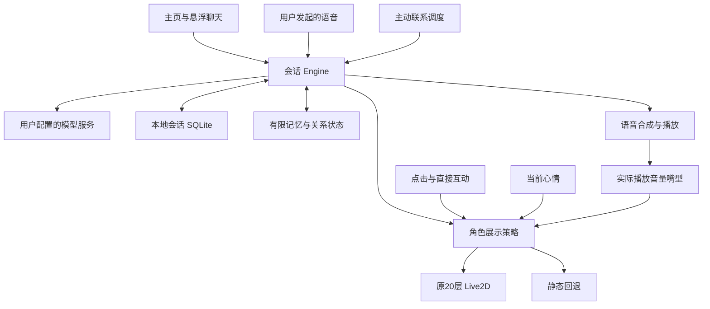

# 实现结构与边界

此文描述内部实现，展示仓库不提供相应源码文件。

`app/.../companion` 负责会话与人格上下文，`conversation` / `memory` 负责持久化与有限记忆规则；`continuity` 提供关系及主动联系。`provider`、`voice`、`vision` 适配外部服务。`overlay` 负责系统窗口和交互，`character` 负责原动作、持续心情与生命周期。

Live2D 不是聊天模型。持续心情基线不依赖自主动作是否可播放；显式互动、手动保持和说话优先，结束回当前心情。语音、文字和看屏幕使用已有会话入口，不另造独立人格或聊天历史。

所有GL操作由专用工作线程管理。熄屏、隐藏和静态切换停止对应渲染，按生命周期释放/恢复；不承诺未经长测的CPU、耗电或全天稳定性指标。

`cubism/` 是独立许可的官方Framework快照及本地适配，非本项目自研底层引擎；相关原许可与本地修改记录在作者保留的工程中管理。Core AAR由开发者在本机从官方获取。
